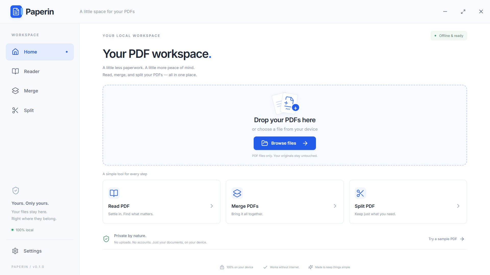

<p align="center">
  
</p>

# Paperin

**Read, merge, split, and add signature images to PDFs right on your computer.**

Paperin is an offline PDF workspace for Windows. No account or document uploads required. Free and open source under the MIT license.

## Download for Windows

### [⬇ Download Paperin for Windows (.exe)][download]

[Download and installation guide](docs/INSTALLATION.md) · [User guide](docs/USER-GUIDE.md) · [All releases][releases]

The download button links **directly to the `Paperin-Setup.exe` installer** from the latest public release. You only need this one file. There is no need to install Node.js, npm, Git, or qpdf separately.

### Quick installation

1. Click **Download Paperin for Windows (.exe)** and wait for the download to finish.
2. Open your **Downloads** folder and double-click `Paperin-Setup.exe`.
3. Wait for installation to complete, then open **Paperin** from the Start Menu.
4. Click **Browse files** to open a PDF, or **Try a sample PDF** to explore the app with a sample document.

The installer is currently unsigned. If Windows displays an unknown publisher warning, verify the download source first. See the [installation guide](docs/INSTALLATION.md#windows-smartscreen-warning) for details.

## Screenshot



## Features

| Feature                      | What you can do                                                                                  |
| ---------------------------- | ------------------------------------------------------------------------------------------------ |
| **Reader**                   | Read PDFs, browse thumbnails, navigate pages, zoom from 25–300%, copy text, and search for text. |
| **Merge**                    | Combine multiple PDFs, arrange their order, and preview the result before saving.                |
| **Split**                    | Extract pages, remove pages from a copy, split by ranges, or create a PDF every N pages.         |
| **Add Signature**            | Import a PNG signature image, adjust its position and size, and save a new PDF.                  |
| **Local processing**         | Open and process documents without accounts, uploads, or cloud services.                         |
| **Original file protection** | Save results to new files. The app prevents using a source file as an export destination.        |

The app and documentation are in English. The guides use the button labels shown in the app.

## Requirements and limitations

- Packages are provided for **Windows x64**. Installers for macOS, Linux, 32-bit Windows, and Windows ARM are not currently available.
- Internet access is needed to download the installer. Once installed, you can read and process PDFs offline.
- The current import limit is **512 MB per PDF**. Memory usage increases with the size and number of open documents.
- Search works on PDFs with a text layer. OCR for scanned documents is not available.
- Added signatures are **visual images**. They do not provide identity verification or certificate-based digital signing.
- The signature editor does not support encrypted PDFs, documents with existing digital signatures, or signature form fields.
- Merging or splitting pages can affect bookmarks, forms, attachments, and existing digital signature validity.
- OCR, annotations, printing, recent-file history, and automatic updates are not available. Check the [latest releases][releases] to update manually.

## Privacy

Paperin processes documents on your device, without login, app telemetry, CDNs, or automatic update checks. External network requests from the packaged app session are blocked. Signature images and placement history stay in memory during the editing session.

Save your work before closing the app. If a multi-file export fails partway through saving, files already saved may remain in the destination folder. Check the export result message.

## Documentation

- [Download, installation, updates, uninstalling, and troubleshooting](docs/INSTALLATION.md)
- [Using Reader, Merge, Split, and Add Signature](docs/USER-GUIDE.md)
- [Source setup, architecture, builds, and testing](docs/DEVELOPMENT.md)
- [Publishing source code and installers through GitHub Releases](docs/GITHUB-RELEASES.md)

## For developers

Use Windows x64 with **Node.js 22.13+ on the 22.x release line**, or **Node.js 24+**.

```powershell
npm ci
npm run setup:qpdf
npm run dev
```

Build an installer:

```powershell
npm run make
```

Output: `dist/make/squirrel.windows/x64/Paperin-Setup.exe`. See the [development guide](docs/DEVELOPMENT.md) for command details and testing limitations.

## Reporting issues

Open a [GitHub issue][issues] with your app version, Windows version, steps to reproduce, and any error messages. Use a sample PDF without sensitive information instead of uploading private documents.

## License

Paperin is released under the [MIT license](LICENSE). Third-party components retain their own licenses. See the [third-party notices](resources/THIRD_PARTY_NOTICES.md).

[download]: https://github.com/nusahid/paperin/releases/latest/download/Paperin-Setup.exe
[releases]: https://github.com/nusahid/paperin/releases
[issues]: https://github.com/nusahid/paperin/issues
